# CivicSathi AI

**Government services, made easier to understand.**

CivicSathi is an independent information assistant for Telangana public services. Ask in English, Telugu, or Telugu-English to find service records, forms, schemes, official sources, and researched document checklists.

> CivicSathi is not a government website. It does not submit applications or complaints, accept payments, decide eligibility, or track application status. Confirm current requirements with the linked official source.

## See the app

Screenshots below are captured from the running website. Select any image to view it full size.

<table>
  <tr>
    <td align="center"><a href="docs/images/civicsathi-ask.png">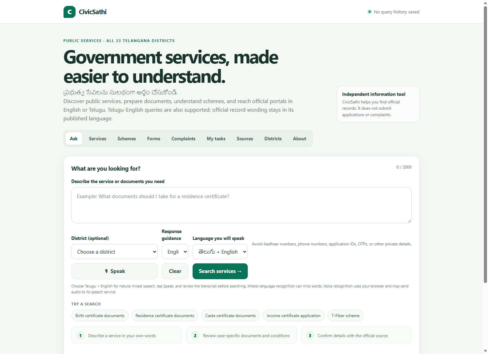</a><br><sub>Ask</sub></td>
    <td align="center"><a href="docs/images/civicsathi-search.png">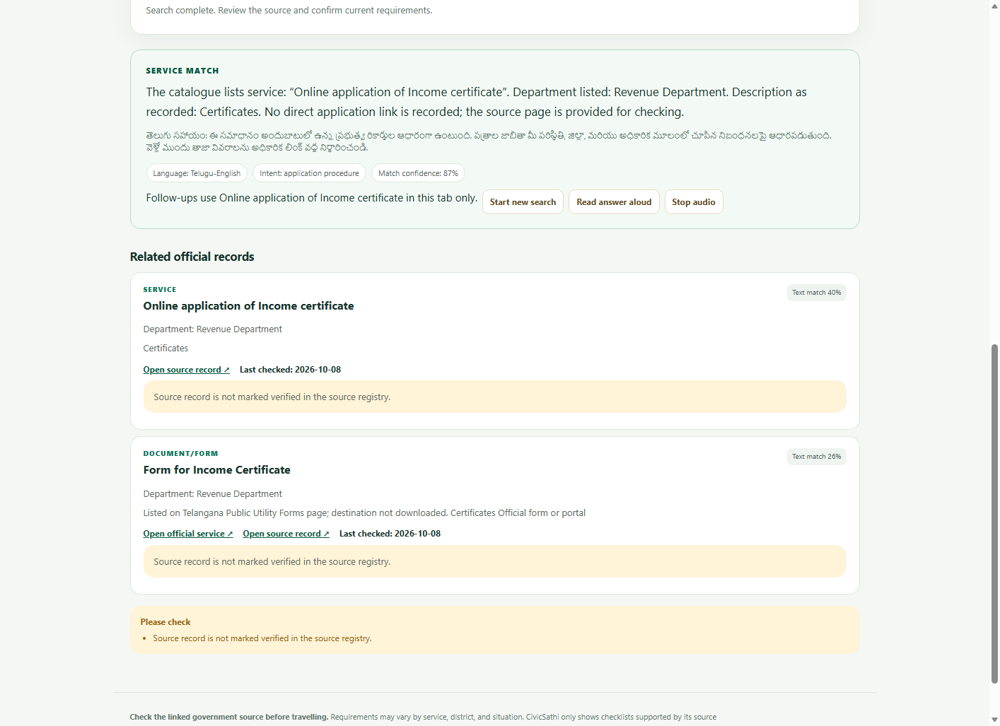</a><br><sub>Search results</sub></td>
    <td align="center"><a href="docs/images/civicsathi-services.png">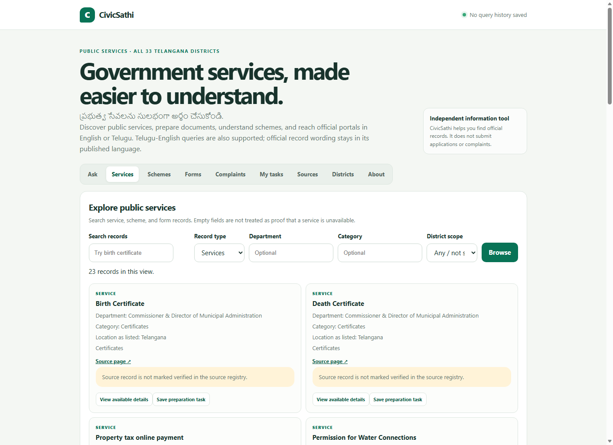</a><br><sub>Services</sub></td>
  </tr>
  <tr>
    <td align="center"><a href="docs/images/civicsathi-schemes.png">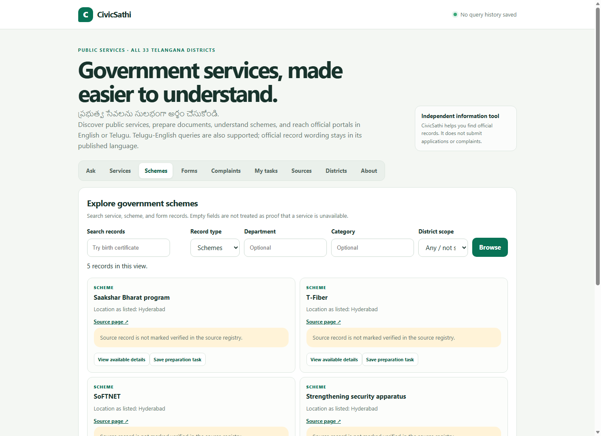</a><br><sub>Schemes</sub></td>
    <td align="center"><a href="docs/images/civicsathi-forms.png">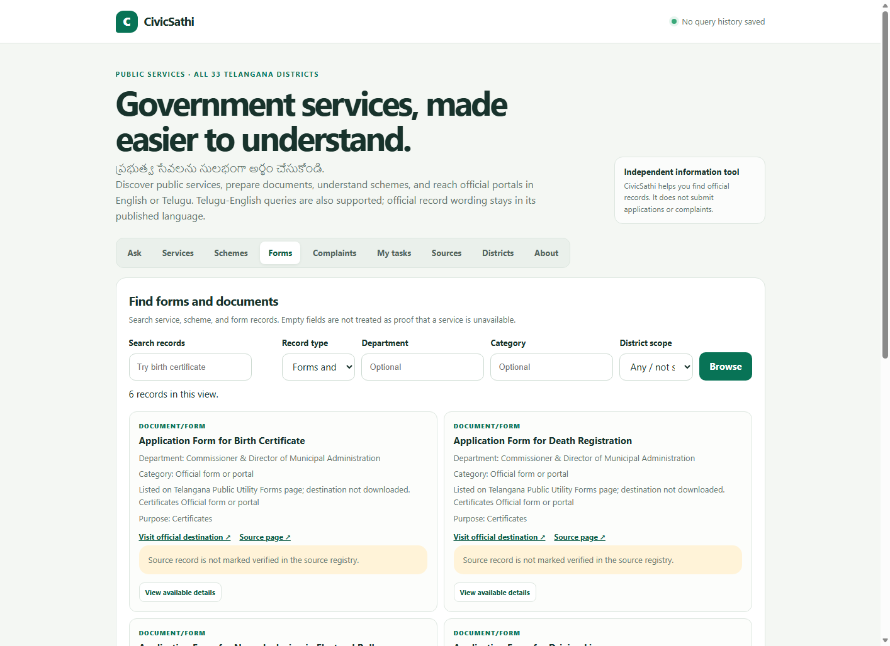</a><br><sub>Forms</sub></td>
    <td align="center"><a href="docs/images/civicsathi-complaints.png">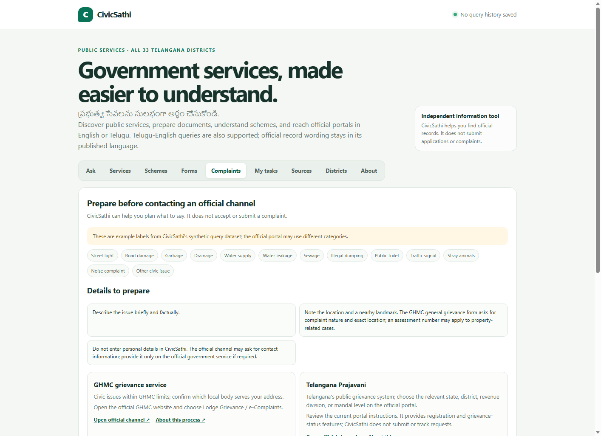</a><br><sub>Complaints</sub></td>
  </tr>
  <tr>
    <td align="center"><a href="docs/images/civicsathi-tasks.png">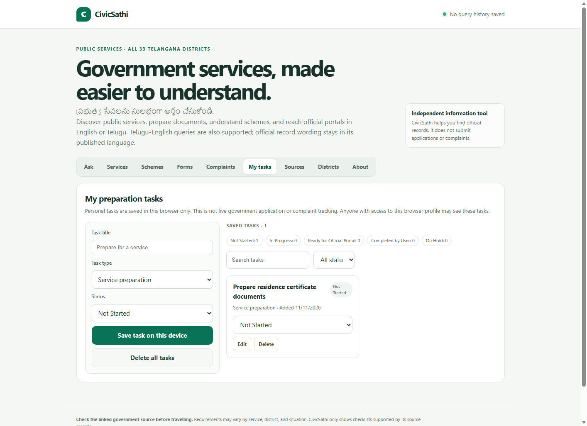</a><br><sub>My tasks</sub></td>
    <td align="center"><a href="docs/images/civicsathi-sources.png">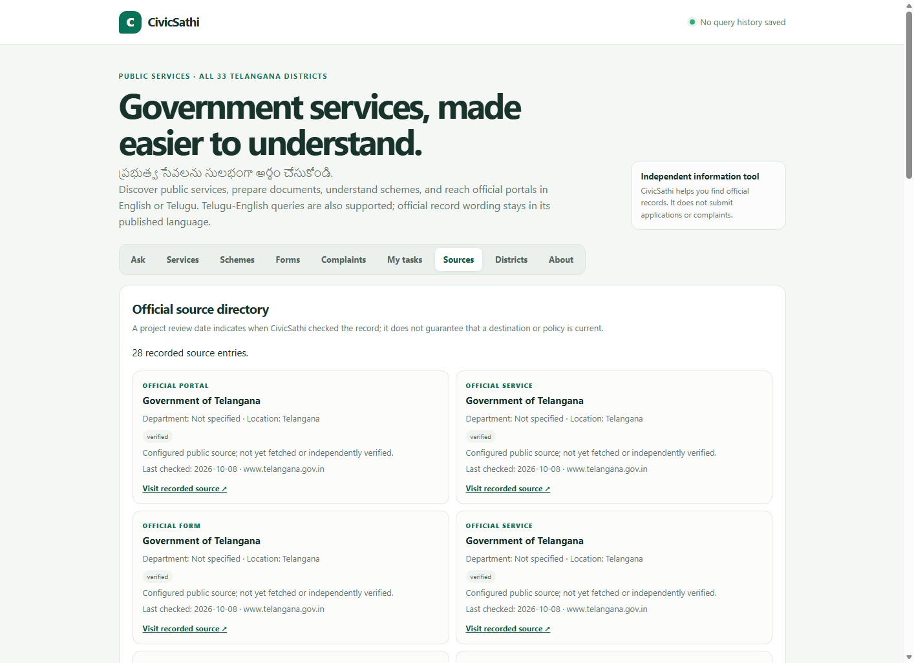</a><br><sub>Sources</sub></td>
    <td align="center"><a href="docs/images/civicsathi-districts.png">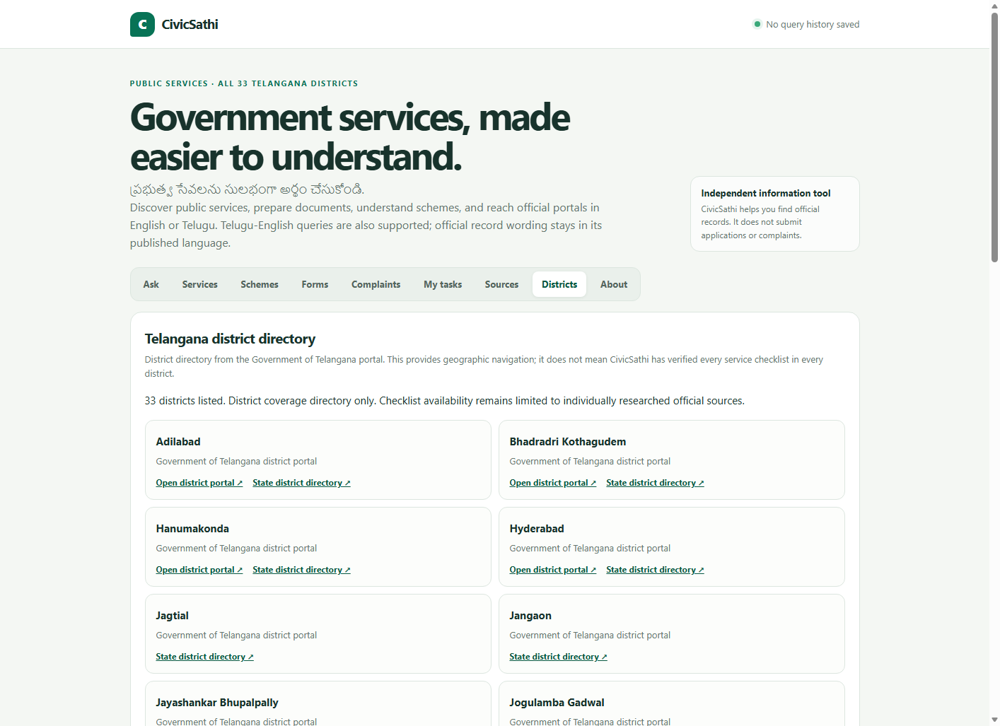</a><br><sub>Districts</sub></td>
  </tr>
  <tr>
    <td align="center"><a href="docs/images/civicsathi-about.png">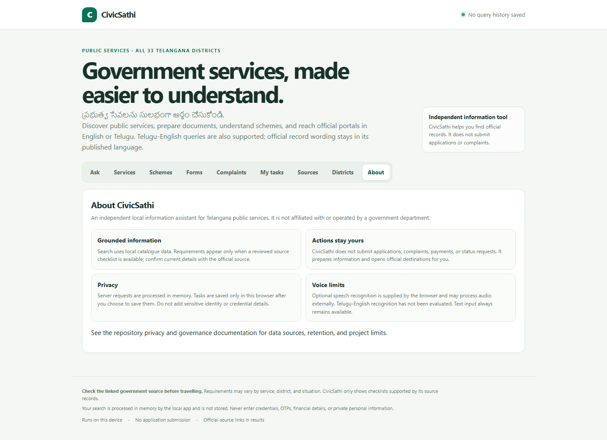</a><br><sub>About</sub></td>
    <td></td>
    <td></td>
  </tr>
</table>

## What you can do

- Search for services, forms, schemes, and official links in English, Telugu, or Telugu-English.
- Browse records and select from the Telangana district directory.
- Review official-source links and see when a record is unverified or may need checking.
- Prepare documents using a checklist when a researched service scenario is available.
- Draft civic complaint information before visiting an official channel. CivicSathi does not submit it.
- Optionally use browser speech recognition and read-aloud controls.
- Save personal preparation tasks in your browser when you choose.

## Run locally

Use Python 3.11 or later. From the project root, create an environment and install dependencies:

```powershell
py -3.11 -m venv .venv
.\.venv\Scripts\Activate.ps1
python -m pip install -r requirements.txt
```

Train the local intent model and start the app:

```powershell
python -m src.nlp.train
python -m src.app.server
```

Open <http://127.0.0.1:8000>. Stop the server with `Ctrl+C`.

The processed CSV datasets are included in the repository. The trained `.joblib` model is generated locally and ignored by Git, so run the training command after cloning. To rebuild the processed data package manually, run `python -m src.data_processing.build_datasets` before training.

## How it works

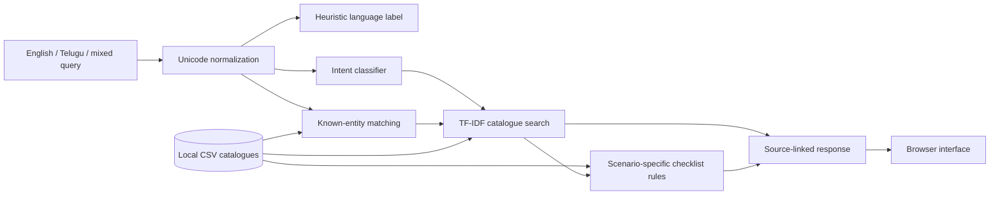

The browser sends queries to a local Python API. The backend normalizes the text, estimates language, predicts an intent, extracts known entities, ranks catalogue records, and returns a response with source context. Responses are built from catalogue information and templates; CivicSathi does not use an LLM to generate answers.

## Data included

| Dataset | Rows | Use |
|---|---:|---|
| Citizen query examples | 1,296 | Synthetic: 12 intents × 108 examples; 432 examples each for English, Telugu, and Telugu-English |
| Complaint query examples | 624 | Synthetic: 13 civic issue categories; 208 examples per language label |
| Service catalogue | 23 | Service names and available department/source details |
| Government schemes | 5 | Scheme records |
| Forms and documents | 6 | Form/document records |
| Official sources | 28 | Source links; 16 marked verified and 12 marked for review in the local registry |
| Document requirements | 35 | Checklist items tied to service scenarios and jurisdictions |
| Telangana districts | 33 | District directory for navigation |

The query examples are synthetic and annotated; they are not real citizen conversations. Source status is a registry field, not a guarantee that a live page is current. The district directory does not mean that every service or checklist has been researched in every district. Checklist coverage is limited to recorded GHMC birth/death cases, MeeSeva residence-certificate scenarios, and a Suryapet-only caste-certificate case. If no checklist matches, check the official source.

Official source starting points are listed in `config/sources.yaml`. Collection helpers gather public-page candidates; those records are reviewed and validated before being used in the processed CSV catalogues. The query examples are generated from templates for NLP development and evaluation, not scraped from citizens.

## NLP methods

- **Preprocessing:** Unicode NFC normalization, removal of selected invisible characters, and whitespace cleanup. Telugu script is preserved.
- **Language identification:** A heuristic checks Telugu/Latin scripts and selected romanized Telugu markers. It is not a trained language-identification model.
- **Intent classification:** scikit-learn TF-IDF features (word 1–2 grams and character 2–5 grams) feed a Logistic Regression classifier. Calibrated LinearSVC was compared during training. A confidence threshold provides a fallback for uncertain predictions.
- **Entity extraction:** Longest-first dictionary matching over known service, department, scheme, form, district, and complaint-category records, with date patterns. This is not trained NER.
- **Retrieval:** Word-level TF-IDF and cosine similarity rank catalogue records. Despite the module filename `semantic_retrieval.py`, this is lexical retrieval; there are no embeddings or vector database.

The held-out intent metrics are perfect on the generated template dataset. They do not show expected performance on real citizens' queries. The retrieval evaluation has only eight manually written English judgments. Telugu and code-mixed quality still need independent native-speaker evaluation.

## Technology

- **Frontend:** HTML, CSS, and browser JavaScript in `src/app/static/index.html`.
- **Backend:** Python standard-library `HTTPServer` and JSON API.
- **Data:** UTF-8 CSV files and pandas.
- **NLP/ML:** scikit-learn, regex, and joblib.
- **Source-collection utilities:** requests, BeautifulSoup, lxml, and PyYAML.
- **Notebooks and tests:** Jupyter, matplotlib, seaborn, and pytest.
- **Database:** None. Query requests are processed in memory; explicitly saved tasks use browser `localStorage`.

## API routes

- `GET /api/health` — service status.
- `GET /api/services`, `/api/schemes`, `/api/documents` — browse catalogue records.
- `GET /api/sources`, `/api/districts` — browse source and district records.
- `GET /api/search?q=...` — rank matching records.
- `POST /api/query` (also `/api/analyze`) — analyze a citizen query.
- `POST /api/complaints/analyze` (also `/api/complaints/draft`) — prepare an unsent complaint draft.

## Run checks

```powershell
python -m pytest -q
python -m src.nlp.retrieval_evaluation
```

The tests cover data validation, NLP components, and API behavior. They do not evaluate microphone accuracy or provide a broad real-world language benchmark.

## Deploy a course preview on Render

The app serves both its frontend and backend from one Python web service.

1. Create a Render Web Service connected to this repository and the `main` branch. Select the **Python 3** runtime and leave the root directory at the repository root.
2. Set the build command to:

   ```bash
   pip install -r requirements.txt && python -m src.nlp.train
   ```

3. Set the start command to:

   ```bash
   python -m src.app.server --host 0.0.0.0
   ```

4. Set the health check path to `/api/health`, then deploy.

The server reads Render's `PORT` environment variable. This is a course preview, not a production government service; see [deployment notes](docs/deployment.md) before exposing it publicly. Render requires web services to bind to `0.0.0.0` and the assigned port ([Render web-service documentation](https://render.com/docs/web-services)).

## Project structure

```text
src/app/             Website server, application service, and static UI
src/nlp/             Preprocessing, intent, entities, retrieval, and pipeline
data/processed/      Local catalogue and synthetic query CSV datasets
src/data_processing/ Dataset building, cleaning, and validation
src/data_collection/ Public-source collection helpers for manual review
notebooks/           Data and NLP walkthroughs
models/nlp/           Model configuration and evaluation metrics
reports/              Data quality and NLP evaluation references
tests/                 Automated tests
```

## Privacy and source quality

Search requests are not saved by the backend. Pattern checks reject some common sensitive identifiers but may not catch every kind of personal information. Avoid entering credentials, OTPs, Aadhaar/PAN numbers, phone numbers, financial details, or private addresses. Browser speech recognition may send audio to the browser provider; review the transcript before searching.

Source data can be incomplete, stale, or unverified. Do not treat a blank catalogue field as proof that a service is unavailable. Confirm current details on the official page before applying or travelling.

## License

This project is released under the MIT License. See [LICENSE](LICENSE).
