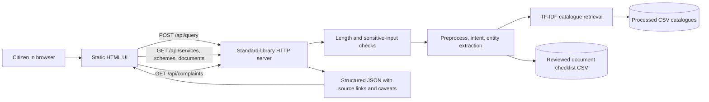

# Project Architecture

CivicSathi is a local, read-only Python application. It uses CSV catalogues and a locally trained scikit-learn intent model; no external LLM, hosted database, or government transaction integration is required to run it.

## Modules

- `src/app/server.py`: loopback-only HTTP routes and payload validation.
- `src/app/service.py`: query orchestration, browsing filters, and complaint guidance response.
- `src/app/static/index.html`: responsive search, catalogue browsing, checklist, and complaint guidance UI.
- `src/nlp/preprocessing.py`: Unicode normalization and heuristic language detection.
- `src/nlp/intent_classifier.py`: trained TF-IDF intent model and low-confidence fallback.
- `src/nlp/entity_extractor.py`: longest-match catalogue dictionary and grounded aliases.
- `src/nlp/semantic_retrieval.py`: unified TF-IDF lexical retrieval across services, schemes, forms, and sources.
- `src/nlp/document_requirements.py`: groups manually reviewed official requirements by service/scenario/jurisdiction.
- `src/data_processing/validation.py`: schema, label, source, privacy-pattern, and dataset-manifest validation.

## Runtime boundaries

The browser sends a query only to the local server. The server does not persist request bodies or log URLs. It rejects patterns resembling sensitive identifiers before prediction/retrieval. The complaint screen only prepares citizens to use external official channels; it never submits a complaint or asks the user to enter complaint details into CivicSathi. Official links open in a separate browser tab.

The development server is limited to loopback. It is not configured for internet-facing deployment; production hosting requires a separate privacy, security, operations, and source-maintenance review.
