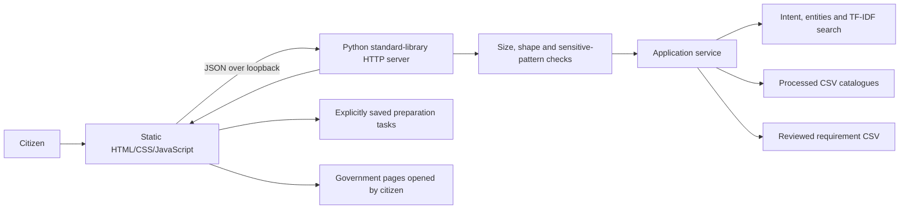

# System Architecture

The backend owns catalogue access, input checks, query analysis and structured complaint draft preparation. The browser owns presentation, user-reviewed edits, optional browser speech, and tasks saved only after an explicit user action. No raw task data or complaint draft is written by the server. Browser local storage is visible to anyone using that browser profile, so sensitive information must not be put in task notes.

The application remains functional without external AI, embeddings, or speech APIs. Speech recognition is a browser capability, not a guaranteed local model; ask the user to read the disclosure before using it.
