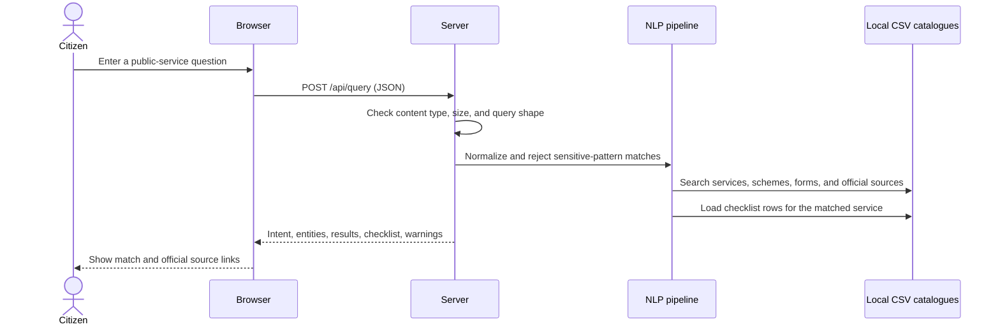

# System Flow

## Query assistant

1. The browser collects a query string and optional district choice; it does not save it.
2. The local endpoint validates the JSON body and enforces a 2,000-character query limit.
3. Sensitive-pattern checks run before classifier prediction or retrieval.
4. Preprocessing normalizes whitespace/Unicode while preserving Telugu script and code-mixed tokens.
5. Intent classification returns a supported label only above its configured threshold.
6. Catalogue entities and TF-IDF retrieval identify candidate records; source fields and warnings are retained.
7. Document requirements are attached only where a service ID and reviewed checklist rows match. District-specific records stay scoped.
8. The UI shows source links, applicability, conditions, and a clarification notice when the catalogue cannot support a checklist.

## Browse records

The UI calls `GET /api/services`, `/api/schemes`, or `/api/documents`; filters are applied to the in-memory catalogue index. `GET /api/search?q=...` returns ranked matches. Browsing never modifies catalogue data.

## Complaint guidance

`GET /api/complaints` returns reviewed official GHMC/Telangana links, a preparation checklist based on the GHMC general grievance form, and the known boundary that CivicSathi cannot register or track a complaint. Synthetic complaint categories are clearly labelled as examples, not an official portal taxonomy.

## Failure and uncertainty handling

- Empty, oversized, invalid, sensitive, and unsupported requests receive explicit responses.
- Low intent confidence returns an unclassified/fallback status.
- Weak lexical matches retain a score and are not represented as verified answers.
- Missing source fields remain unavailable; no fee, eligibility, deadline, or application success is inferred.
- External government destinations are opened by the citizen; the app does not claim to have completed the next step.
